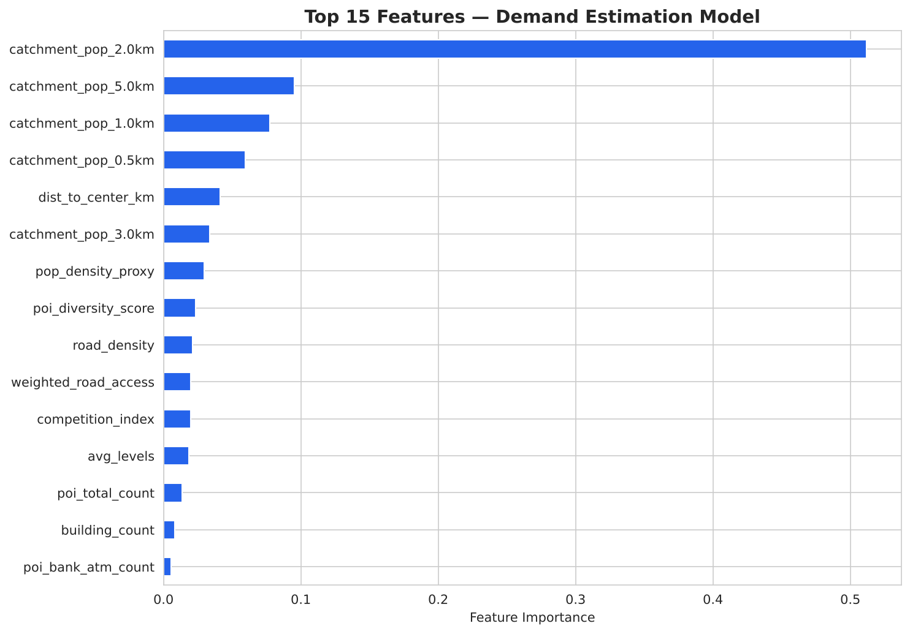
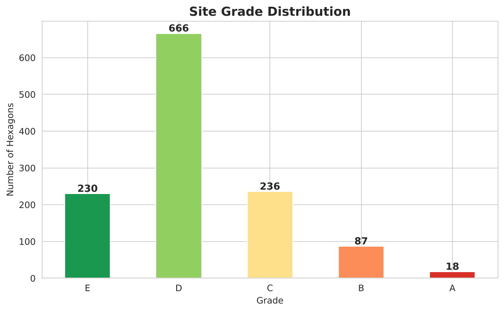
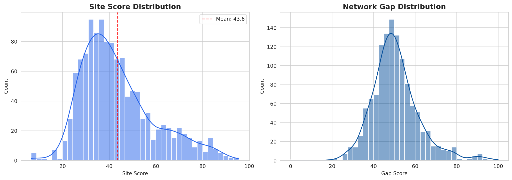
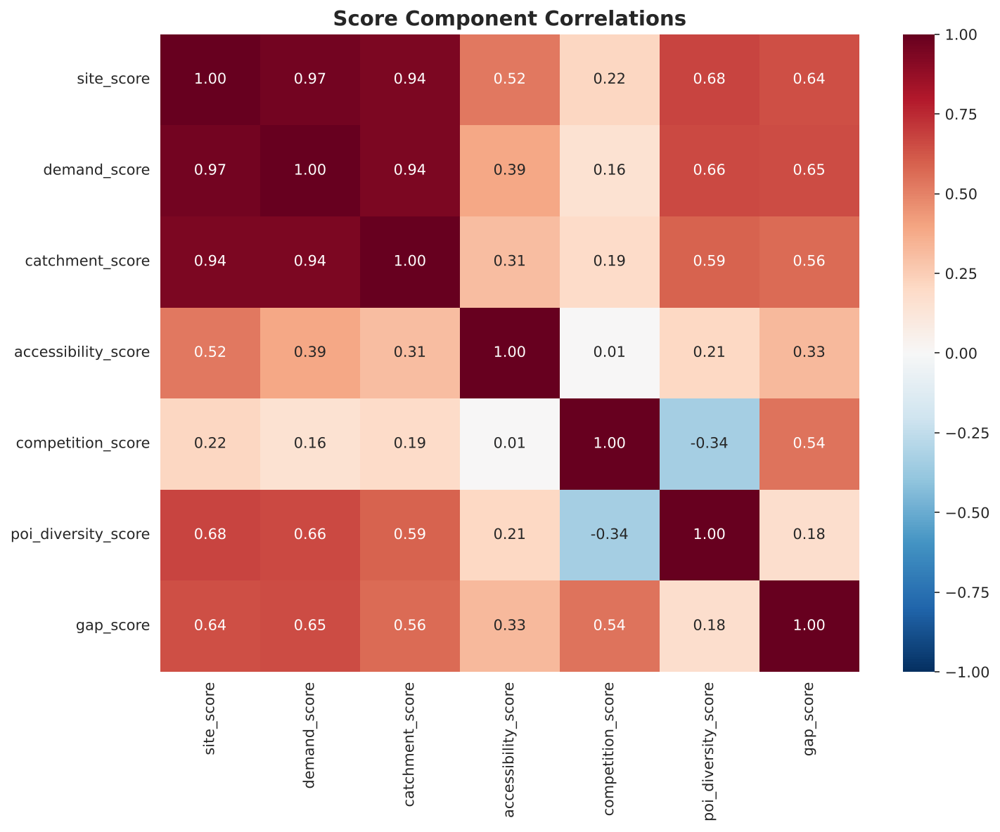
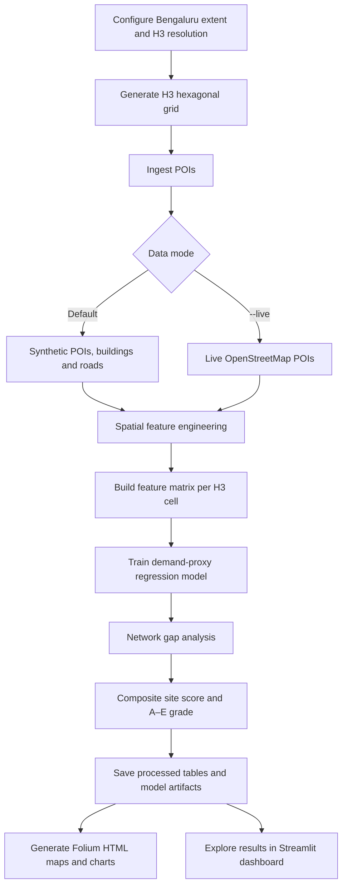

# RetailIQ — Location Intelligence for Retail Site Selection

> A geospatial analytics project for exploring retail expansion opportunities across Bengaluru using H3 hexagonal indexing, points of interest, spatial features, demand proxies, network-gap analysis and an interactive Streamlit dashboard.

[](https://www.python.org/)
[](https://h3geo.org/)
[](https://scikit-learn.org/)
[](https://streamlit.io/)
[](LICENSE)

**Author: Harshith Narasimhamurty**

---

## 1. Project overview

RetailIQ is a prototype decision-support workflow for a retail planning question:

**Which parts of a city may be worth investigating when selecting the next retail location?**

It divides a configured city extent into H3 hexagonal cells and builds spatial indicators for each cell. These indicators are used to estimate a demand proxy, compare demand with nearby commercial supply, and calculate a weighted site-opportunity score. The results can be explored through static interactive maps and a Streamlit dashboard.

The current configuration targets **Bengaluru, India**. This is an analytical prototype, not a substitute for field surveys, commercial due diligence, road-network travel-time analysis or a model trained and validated on actual store sales.

## 2. Explore the published outputs

The repository includes ready-to-open HTML maps in `outputs/`. Use **Interactive preview** to view each map in a browser through HTMLPreview, or **Repository file** to inspect/download the original HTML.

| Output | What it shows | Open |
|---|---|---|
| Site score map | H3 cells coloured by composite site score and grade | [Interactive preview](https://htmlpreview.github.io/?https://github.com/Harshith69/retailiq-location-intelligence/blob/main/outputs/site_score_map.html) · [Repository file](outputs/site_score_map.html) |
| Network gap map | Relative demand-versus-supply gap across the study area | [Interactive preview](https://htmlpreview.github.io/?https://github.com/Harshith69/retailiq-location-intelligence/blob/main/outputs/network_gap_map.html) · [Repository file](outputs/network_gap_map.html) |
| Demand heatmap | Spatial distribution of the modelled demand proxy | [Interactive preview](https://htmlpreview.github.io/?https://github.com/Harshith69/retailiq-location-intelligence/blob/main/outputs/demand_heatmap.html) · [Repository file](outputs/demand_heatmap.html) |
| Feature importance | Relative contribution of model features | [View PNG](outputs/feature_importance.png) |
| Grade distribution | Distribution of A–E location grades | [View PNG](outputs/grade_distribution.png) |
| Score distributions | Distribution of site and gap scores | [View PNG](outputs/score_distributions.png) |
| Correlation matrix | Pairwise correlations among score components | [View PNG](outputs/correlation_matrix.png) |

> **Map preview note:** The interactive preview links use the third-party HTMLPreview service to render the HTML committed in this repository. The map source files remain hosted in this repository. If the preview service is unavailable, download the repository HTML file and open it locally. Folium basemap tiles are loaded from the configured tile provider, so an internet connection may be required.

### Visual outputs at a glance

The following figures are available directly in the repository. The interactive map links above provide the geographic context and basemap.









## 3. Process at a glance

The following flow summarises the execution order in the codebase.



### Base map and spatial layers

The analysis is organised around a common H3 grid. The grid provides the spatial key used to aggregate point and line data and to compare neighbouring areas. Folium maps use a street/light basemap layer for context, while the H3 cells carry the analytical values.

| Spatial layer | Current implementation |
|---|---|
| H3 grid | Generated from the configured Bengaluru bounding box at resolution 8 |
| Points of interest | Synthetic by default; OSM Overpass POIs when `--live` is used |
| Buildings | Synthetic building points and floor-level proxy |
| Roads | Synthetic road segments |
| Population | Building-derived proxy and catchment aggregation; not a direct census population surface |

**Important data qualification:** `--live` currently switches the POI source to OpenStreetMap. It does not make the building, road or population layers live. Kontur population and Census 2011 are mentioned as potential/source context in project documentation but are not currently downloaded and integrated by the supplied pipeline.

## 4. Run the project locally

### Prerequisites

- Python 3.11 or later
- Git
- Internet access if you intend to retrieve OpenStreetMap POIs or load external map tiles

### Windows PowerShell

```powershell
git clone https://github.com/Harshith69/retailiq-location-intelligence.git
cd retailiq-location-intelligence

# Create and activate an isolated environment
py -3.11 -m venv .venv
.\.venv\Scripts\Activate.ps1

# Upgrade pip and install dependencies
python -m pip install --upgrade pip
pip install -r requirements.txt

# Run the full pipeline (synthetic data by default)
python run_pipeline.py

# Generate the static HTML maps and PNG charts
python -m src.generate_outputs

# Launch the interactive dashboard
streamlit run src/dashboard.py
```

### macOS / Linux

```bash
git clone https://github.com/Harshith69/retailiq-location-intelligence.git
cd retailiq-location-intelligence

python3.11 -m venv .venv
source .venv/bin/activate
python -m pip install --upgrade pip
pip install -r requirements.txt

python run_pipeline.py
python -m src.generate_outputs
streamlit run src/dashboard.py
```

Open the local Streamlit URL printed in the terminal (normally `http://localhost:8501`).

### Use live OpenStreetMap POIs

```bash
python run_pipeline.py --live
python -m src.generate_outputs
streamlit run src/dashboard.py
```

The Overpass API is a shared public service. Requests can be slow or rate-limited; use the default synthetic mode for repeatable local demonstrations.

### Open an existing HTML map without rerunning the pipeline

After downloading/cloning the repository, open any of these files directly in a browser:

- `outputs/site_score_map.html`
- `outputs/network_gap_map.html`
- `outputs/demand_heatmap.html`

To regenerate the HTML files and charts, first run `python run_pipeline.py`, then run `python -m src.generate_outputs`.

## 5. Methodology

### 5.1 H3 spatial indexing

The configured Bengaluru bounding box is sampled and mapped to H3 cells at resolution 8. Each cell is represented by an H3 index and polygon geometry. The grid acts as the shared spatial unit for feature aggregation and map visualisation.

### 5.2 Feature engineering

The implementation creates spatial indicators including:

- Building-derived population-density proxy and building-level summaries
- POI counts by category (restaurants, retail, banks/ATMs, education, healthcare, entertainment, transport and fuel)
- Catchment aggregates at configured distance bands
- Road density and road-type-weighted accessibility
- Competition/supply proxy
- POI category diversity using Shannon entropy
- Distance from the configured city centre

The exact feature columns are defined by `src/feature_engineering.py`; the project documentation has referred to 26 features, but this count should be treated as implementation-dependent and verified against the generated feature matrix.

### 5.3 Demand estimation

The modelling module trains a Gradient Boosting regression model on a generated demand/revenue proxy derived from spatial features. This is useful for demonstrating the end-to-end modelling workflow, feature importance and spatial ranking.

**It is not a model of observed retail revenue.** Its evaluation metrics describe performance against synthetic labels and must not be presented as evidence of commercial forecasting accuracy. Replacing the proxy target with verified store-level revenue, footfall or transaction data is required for real-world predictive claims.

### 5.4 Network gap analysis

The project compares normalised demand and supply proxies. The documented gap expression is:

```text
Gap score = Normalised demand - 0.7 × Normalised supply
```

The resulting value is used to rank areas by relative unmet-demand potential. It is an exploratory index, not a measured market-size estimate.

### 5.5 Composite site score

The configured score combines five components:

| Component | Weight | Interpretation |
|---|---:|---|
| Demand | 30% | Demand-proxy model output |
| Catchment | 25% | Nearby population/building proxy |
| Accessibility | 15% | Road-related indicator |
| Competition (inverse) | 15% | Lower estimated supply can improve score |
| POI diversity | 15% | Variety of surrounding POI categories |
| **Total** | **100%** | |

The score is scaled to 0–100 and categorised into grades A–E. Refer to `src/models.py` and `src/config.py` for the executable definitions and thresholds.

## 6. Dashboard

The Streamlit dashboard in `src/dashboard.py` presents five views:

1. **Site Scores** — H3 cells coloured by composite score.
2. **Demand Heatmap** — spatial view of demand-proxy estimates.
3. **Network Gaps** — relative demand/supply gap areas.
4. **Analytics** — distributions, component correlations and leading cells.
5. **Site Report** — selected-cell score components and feature details.

Start it with:

```bash
streamlit run src/dashboard.py
```

The dashboard expects the processed Parquet files produced by the pipeline to exist.

## 7. Repository structure

```text
retailiq-location-intelligence/
├── README.md
├── LICENSE
├── requirements.txt
├── pyproject.toml
├── run_pipeline.py
├── src/
│   ├── config.py                 # Study area, H3 and modelling parameters
│   ├── data_ingestion.py         # H3 grid and spatial data ingestion/generation
│   ├── feature_engineering.py    # Spatial aggregation and feature matrix
│   ├── models.py                 # Demand proxy, gap analysis and site scoring
│   ├── generate_outputs.py       # Folium HTML maps and analytical charts
│   └── dashboard.py              # Streamlit exploration interface
├── data/
│   ├── raw/                      # Generated/downloaded spatial inputs
│   └── processed/                # Grid, feature matrix and scores
└── outputs/
    ├── site_score_map.html
    ├── network_gap_map.html
    ├── demand_heatmap.html
    ├── feature_importance.png
    ├── grade_distribution.png
    ├── score_distributions.png
    └── correlation_matrix.png
```

Generated data and model files are created when the pipeline runs; they may not all be committed to version control.

## 8. Main code entry points

| File | Responsibility |
|---|---|
| `run_pipeline.py` | Orchestrates ingestion, features and modelling |
| `src/config.py` | Central project configuration |
| `src/data_ingestion.py` | H3 grid, synthetic layers and OSM POI retrieval |
| `src/feature_engineering.py` | Spatial joins, H3 aggregation and feature creation |
| `src/models.py` | Demand proxy model, gap calculations and score grades |
| `src/generate_outputs.py` | Static interactive maps and PNG outputs |
| `src/dashboard.py` | Streamlit dashboard |

## 9. Current limitations and next improvements

- The default data path is synthetic; only POIs switch to live OSM in live mode.
- The demand target is synthetic and should be replaced with an observed business outcome before commercial use.
- Catchment aggregation uses H3 neighbourhood logic; validate the resulting distances against exact geodesic or network-based catchments for deployment.
- Random train/test splits can overstate performance where nearby cells are spatially correlated; spatial block validation is recommended.
- Fit preprocessing transformations on training data only to avoid leakage.
- Pin and test a compatible dependency set. The source uses H3 v4-style API names, while the current requirements file pins H3 3.7.7; reconcile this before installing/running in a clean environment.
- Add automated unit/integration tests for ingestion, feature schema, scoring bounds and reproducibility.
- A future production version should integrate authoritative population data, real road networks/travel times, observed store performance and data provenance.

## 10. Data sources and references

- [OpenStreetMap](https://www.openstreetmap.org/) — volunteered geographic data.
- [Overpass API](https://overpass-api.de/) — query interface used by the live POI ingestion path.
- [H3 documentation](https://h3geo.org/) — hierarchical hexagonal spatial indexing.
- [GeoPandas documentation](https://geopandas.org/) — geospatial data processing.
- [scikit-learn documentation](https://scikit-learn.org/stable/) — regression and model evaluation.
- [Folium documentation](https://python-visualization.github.io/folium/) — interactive Leaflet map generation.
- [Streamlit documentation](https://docs.streamlit.io/) — dashboard framework.

OpenStreetMap data is made available under the [Open Database Licence (ODbL)](https://www.openstreetmap.org/copyright). Review the applicable attribution and licence obligations when redistributing OSM-derived data or outputs.

## Author

**Harshith Narasimhamurty**

## License

This project is distributed under the MIT License. See [LICENSE](LICENSE).
